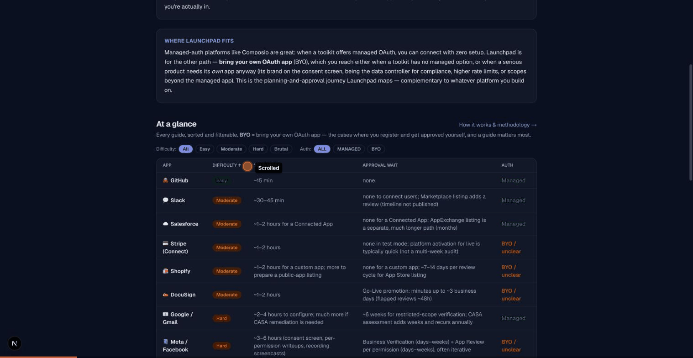

# 🚀 Launchpad — OAuth integration planner for agent builders

**Know what it takes to ship your OAuth integration — before you start.**

**▶ Live demo:** https://oauth-launchpad-seven.vercel.app
(The curated library loads instantly; the "Generate a guide for any app" box runs
a real agent live — give it ~1–2 minutes. Verified end to end in production.)



*The demo above: the filterable at-a-glance matrix (filtered to BYO-only apps) and the interactive
scope toggle flipping Google from Easy (sign-in) to Brutal (Gmail content + CASA).*

To let their users connect an app (Gmail, Slack, Salesforce…), an AI-agent developer
often has to register *their own* OAuth app with the provider and get it approved.
Some take an afternoon; some take weeks and a paid security audit. Today that path is
opaque: you find out about a six-week verification or a $999 review three screens deep,
after you've already committed.

Launchpad turns that opaque, provider-by-provider guessing game into a **clear, shareable
guide** for each app: how hard it is, how long (**separating your hands-on work from the
approval wait**), what will block you, and **which parts an agent can do for you vs. where
you take over**. It ships with a small **source-checked library** and a **live agent** that
investigates any app you type in and produces a guide in the same format.

---

## The problem, and the product decisions that follow

A provider "OAuth app" is the registration the *developer* creates once with the provider.
It's different from the *end-user's* connection (clicking "Allow" at runtime) — but the
developer-app requirements (scopes, verification, branding, review) are exactly what decide
whether end users can connect at all, and whether they see a scary "unverified app" warning.
[Composio's managed-auth directory](https://docs.composio.dev/toolkits/managed-auth) frames
the same split: for ~124 toolkits Composio provides a managed OAuth app (zero setup); for
~258 you must "bring your own OAuth app" — and that second path is the swamp Launchpad maps.

Five decisions fell out of understanding that:

1. **Split time into *active work* vs *approval wait*.** The expensive part is almost never
   the clicking — it's waiting on a human at the provider. Every guide reports both numbers
   separately, because "3 hours of work" and "then 6 weeks of review" are different kinds of cost.

2. **Draw the agent-vs-human line explicitly, per step.** An agent can research, enumerate
   minimal scopes, draft privacy-policy text, pre-fill forms, scaffold code. A human must
   accept legal terms, pay for audits, be the verified entity, and submit. Each step is tagged
   `agent` / `you` / `both`, and there's a two-column summary.

3. **Lead with scope sensitivity.** The *same* provider can be trivial or brutal depending on
   which scopes you request (Gmail is the canonical example). We surface this as a first-class field.

4. **Tag every load-bearing claim with confidence** — `verified` (we confirmed it against a
   source this session), `claimed` (a source states it, unconfirmed), or `uncertain` (we
   couldn't pin it down). Provider docs are stale and agents hallucinate; an honest guide says
   how much to trust each fact.

5. **Name the two-tier pattern.** Almost every provider is fast and review-free for *connecting
   your own users* (first-party app / unlisted OAuth / Connected App), and only gets slow for
   *public marketplace listing* or *sensitive-data scopes*. The fastest way to overestimate the
   work is to assume the scary headline applies to you.

---

## What's in the box

**9 curated, source-checked guides** — deliberately mixing familiar names with uncommon, BYO-only
cases that *no managed platform covers* (the direct rebuttal to "isn't this just Composio?"):

| App | Difficulty | The story |
|---|---|---|
| **GitHub** | easy | Register and it works; no review to connect users. |
| **Slack** | moderate | Instant for your workspace + unlisted OAuth; review only for Marketplace listing. |
| **Stripe** | moderate | Connect OAuth; test mode instant, live needs a quick platform-profile activation. |
| **Salesforce** | moderate | The "scary headline is wrong" case: a Connected App is quick; the $999 AppExchange review is only for marketplace distribution. |
| **DocuSign** | moderate | A *hidden* go-live promotion gate most newcomers don't see coming. |
| **Shopify** | moderate | Clean two-tier: a custom app installs instantly; a public App Store listing is reviewed. |
| **Google / Gmail** | hard | Gmail content = restricted scopes → verification (~6 wks) **+ a paid CASA audit**. |
| **Meta / Facebook** | hard | Business Verification + per-permission App Review with screencasts. |
| **Plaid** | hard | **No managed shortcut exists** — compliance review for Production, and bank OAuth reported up to ~3–4 months. |

**Live generation** — type any app (Notion, HubSpot, Zoom…) and an agent (Claude `opus-5` + web
search) researches its real setup/approval process and returns a guide in the same schema, with a
shareable `/guide/<app>?app=<name>` URL.

**Depth features:**
- **Interactive scope toggle** — on guides where scope decides everything (Google, Plaid, Shopify),
  pick a permission tier and watch difficulty and time change live.
- **"Where Launchpad fits"** — a short homepage note framing Launchpad as *complementary* to
  managed-auth platforms: when managed OAuth exists you connect with zero setup; Launchpad is for the
  bring-your-own-OAuth-app (BYO) path — a toolkit with no managed option, or a product that needs its
  own app anyway (its brand on the consent screen, compliance as data controller, higher rate limits,
  broader scopes).
- **At-a-glance matrix** — every guide, sortable and filterable by difficulty and managed-vs-BYO.
- **[/how-it-works](https://oauth-launchpad-seven.vercel.app/how-it-works)** — a methodology page on the
  evidence model and what was verified vs. not.

**One schema, one renderer.** Curated and live guides share `src/lib/schema.ts` (Zod-validated) and
`src/components/GuideView.tsx`, so a malformed live guide is rejected rather than rendered broken.

---

## Architecture

```
src/
  lib/
    schema.ts            # the Guide schema (Zod + inferred TS types) — the core IP
    guides/              # curated guides (typed objects), validated against the schema at load
      github.ts  slack.ts  google-gmail.ts  salesforce.ts  index.ts
    agent.ts             # live investigator: Claude (claude-opus-5) + web_search, → validated Guide
  app/
    page.tsx             # home: two-tier insight, generate box, library grid
    guide/[slug]/page.tsx# shareable curated guide pages (statically prerendered)
    api/generate/route.ts# POST { app } → { guide }   (live agent; needs ANTHROPIC_API_KEY)
  components/
    GuideView.tsx  GuideCard.tsx  GenerateBox.tsx  chips.tsx
```

The live agent (`src/lib/agent.ts`) streams a Claude request with the `web_search_20260209`
server tool, handles `pause_turn` across multiple search rounds, then extracts a single JSON
object, **sanitizes** it (drops hallucinated/invalid URLs so one bad link can't sink a good
guide), and **validates it with the same Zod schema** the curated guides use.

---

## Setup

Requires **Node 20+** (Next.js 16). If you use `nvm`: `nvm use 20`.

```bash
npm install
cp .env.example .env.local   # then add your key for live generation (optional)
npm run dev                  # http://localhost:3000
```

- The **curated library needs no key** — browse and share it immediately.
- **Live generation** needs `ANTHROPIC_API_KEY` in `.env.local` (gitignored, never committed).
  Optional: `LAUNCHPAD_MODEL` (default `claude-opus-5`) and `LAUNCHPAD_EFFORT` (default `medium`).

### Deploy (Vercel)

This repo is **connected to Vercel for continuous deployment** — every push to `main`
builds and deploys automatically. `ANTHROPIC_API_KEY` is configured as a Vercel env var
(it is never committed). The curated pages are static; `/api/generate` runs as a serverless
function with `maxDuration = 300` (Vercel Fluid Compute honors this, so live generation —
~95s — completes in production, not just locally).

To deploy your own copy: push to GitHub, import the repo at vercel.com, and set
`ANTHROPIC_API_KEY` in the project's environment variables.

---

## Evidence: what we verified, corrected, and could not confirm

This section is deliberately explicit — judging evidence is part of the point.

**Verified in-session (read the actual source):**
- GitHub's required registration fields and the "up to 100 OAuth apps per owner" cap
  ([GitHub docs](https://docs.github.com/en/apps/oauth-apps/building-oauth-apps/creating-an-oauth-app)).
- Slack's three-tier distribution model — undistributed / unlisted-distributed / Marketplace —
  and that only Marketplace listing is reviewed
  ([Slack docs](https://docs.slack.dev/app-management/distribution)).

**Claimed (reputable sources state it; we did not run the flow):**
- Google: Gmail content scopes are *restricted* → verification + **CASA**; restricted
  verification ≈ 6 weeks per Google's FAQ; CASA is a paid, annual third-party audit; unverified
  apps hit a ~100-user cap. Corroborated across Google docs and multiple 2025–2026 practitioner guides.
- Salesforce: AppExchange security review ≈ **$999/attempt** for paid apps and ~2–4 months end
  to end, and it applies to **managed-package distribution**, not to a Connected App used to
  authorize your users' orgs.

**Corrected / judgment calls:**
- **"Salesforce = brutal" is the wrong default.** The famous review applies to AppExchange
  distribution; for the agent-builder's actual use case (connect your users' orgs) a Connected
  App needs no security review. We rated it *moderate* and put the review in blockers.
- **Schema caught a real authoring bug.** An early draft set a step's `estMinutes` to `0`
  ("external audit, not your keystrokes"); Zod rejected it at build time (must be > 0). We
  dropped the field instead of shipping a misleading "0 min."

**Could not verify / known unknowns:**
- Exact review timelines vary widely and change often; treat all time figures as planning
  estimates and confirm against the linked sources.
- Salesforce API/OAuth availability differs by edition — flagged `uncertain` in that guide.

**Live agent — run and spot-checked.** We generated a guide for **Notion** (not in the library)
live: the agent applied the two-tier framework correctly (rated it *easy*; Marketplace listing
in blockers), surfaced real Notion-specific nuance (coarse "capabilities" instead of scopes,
page-scoped consent, irreversible installation scope), and cited 6 real sources. We then
fact-checked three of its claims against Notion's own
[public-connections doc](https://developers.notion.com/guides/get-started/public-connections):
"installation scope is irreversible" (tagged `verified`) ✅ confirmed verbatim; capabilities +
page-scoped consent (tagged `claimed`) ✅ confirmed; "a workspace owner is required to create a
connection" (tagged `verified`) ⚠️ **not stated on the cited page** — a case of the agent
over-applying `verified`. Takeaway: the live output is genuinely useful and mostly well-calibrated,
but `verified` tags from the live agent should still be treated as `claimed` until confirmed. A
one-line system-prompt tightening (require the *specific cited source* to state a fact before
tagging it `verified`) is the obvious next improvement.

**We then applied that fix and re-verified.** A second live run (**HubSpot**) came out *moderate*
with non-obvious findings — a 10/25-account install cap on unlisted apps and a "3 active installs
required before you can list" chicken-and-egg. Every `verified` tag now carried a source URL, and
we spot-checked the install-cap claim against
[HubSpot's own doc](https://developers.hubspot.com/docs/apps/developer-platform/build-apps/manage-apps-in-hubspot):
confirmed verbatim ("up to 10 allowlisted accounts … up to 25 accounts … unlimited after listing").
The find→fix→re-verify loop is the point: the agent's output is useful *and* its confidence
calibration is now auditable.

---

## Limitations

- 4 curated guides, not 100 — a focused slice to demonstrate the format and the live flow.
- The live agent researches via **web search**, not by logging into each provider's real
  console (that needs the developer's own accounts/credentials). It reads and reasons over docs;
  it does not click through the actual setup.
- No persistence for live-generated guides (they render inline; they don't get their own
  shareable URL yet).
- No credentials or accounts are used anywhere in this project.

---

## Tech

Next.js 16 (App Router) · TypeScript · Tailwind CSS v4 · Zod · Anthropic SDK (`claude-opus-5` + `web_search`).
